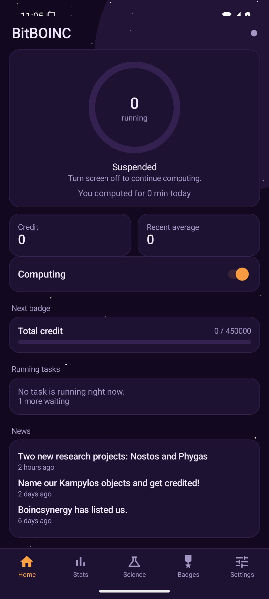
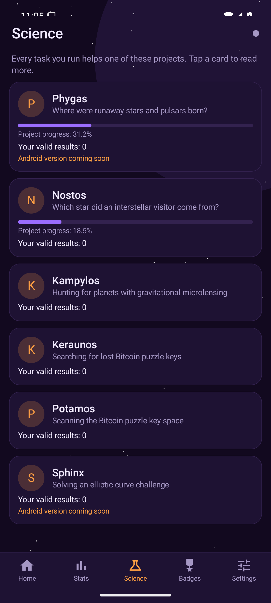
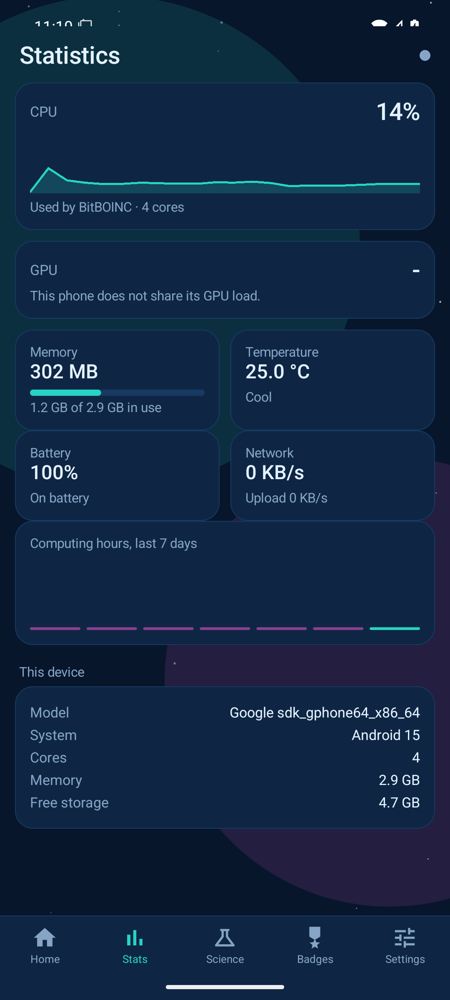
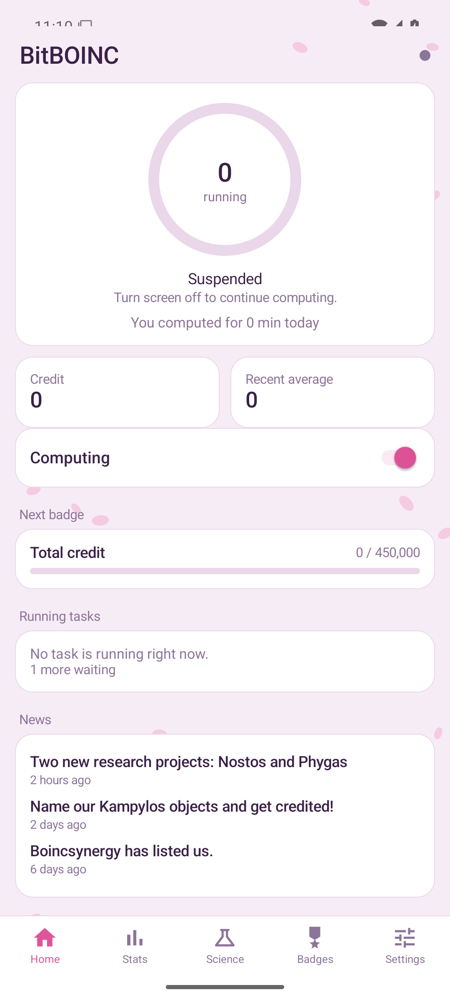

# BitBOINC for Android

An Android app made only for the [BitBOINC](https://bitboinc.athena.org.tr/) volunteer-computing project.
Sign in (or create an account), switch computing on, and watch your tasks, live CPU/GPU/memory/temperature,
credit, badges and the progress of every science application. It is distributed as an APK from the project
website, not through an app store.

## Features

* Single project: BitBOINC only, no project list, a first-start screen to sign in or register.
* Five themes: Cosmic Eye (default), Sakura, Nebula, Night (AMOLED) and Day.
* 18 languages.
* Live device view: running tasks, CPU/GPU load, memory, battery temperature, daily computing time.
* Credit, recent average, badges with the next badge's progress, per-application science progress.
* Runs the standard BOINC client on the device, so tasks behave exactly as in the official BOINC app.

## Requirements

Android 8.0 (API 26) or newer; arm64-v8a, armeabi-v7a or x86_64.

## Layout

* `app/` – the application.
  * `edu.berkeley.boinc.*` – the BOINC client data layer (client service, RPC, parsers), taken from the
    official BOINC Android app and adapted.
  * `org.athena.bitboinc.*` – the BitBOINC user interface, drawn in code (Kotlin).
* `strings_en.json` – source strings for the translations.
* `tools/build_translations.py` – turns translated JSON files (one per language) into
  `res/values-<code>/bb_strings.xml`.
* `tools/publish.sh` – uploads a release APK and `latest.json` to a web server
  (`BB_DEPLOY_HOST`, `BB_DEPLOY_DIR`).

## Building

Requirements: JDK 17, Android SDK 35, Gradle (wrapper included).

1. **Native BOINC client.** The `boinc` binary for each ABI is not in this repository. Build it from
   [BOINC's source](https://github.com/BOINC/boinc) with its Android scripts
   (`android/ci_build_vcpkg_client.sh --arch arm64|arm|x86_64`) and copy the results to
   `app/src/main/assets/<abi>/boinc`.
2. **Debug build:** `./gradlew :app:assembleDebug`
3. **Release build:** create your own keystore and put its settings in
   `~/.bitboinc-android/signing.properties` (`storeFile`, `storePassword`, `keyAlias`, `keyPassword`;
   this file is read by `app/build.gradle.kts` and is never part of the repository), then
   `./gradlew :app:assembleRelease`.

## Licence

BitBOINC for Android is a derivative of the BOINC Android client and is licensed under the
**GNU Lesser General Public License v3.0 or later** (see `LICENSE`, which is supplemented by the GNU GPL v3
text in `COPYING`).

BOINC is © University of California. The BitBOINC name, logo and icon are not covered by this licence;
please do not use them to publish a different app under the BitBOINC name.
